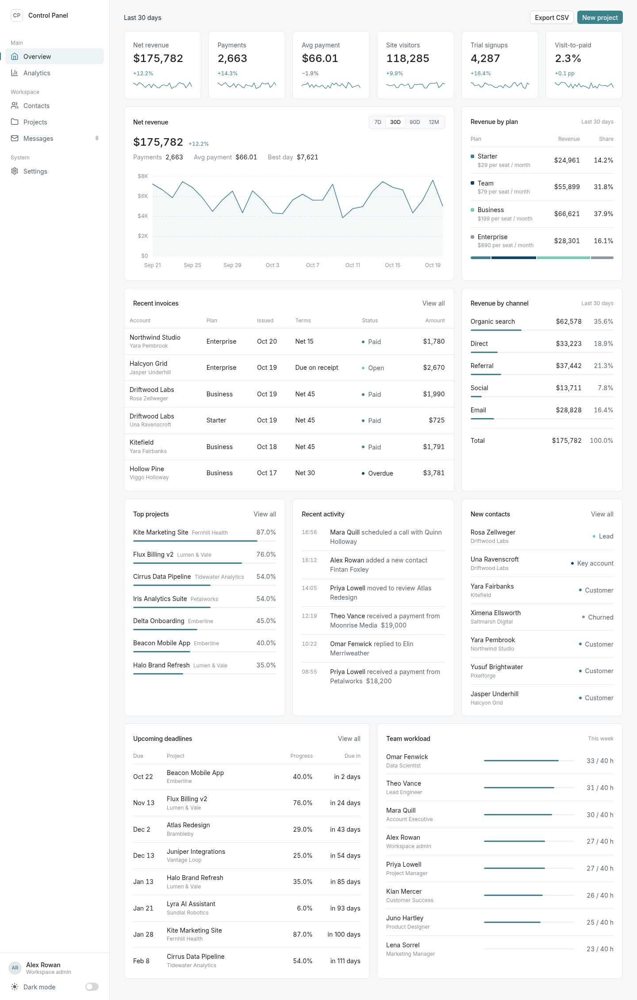
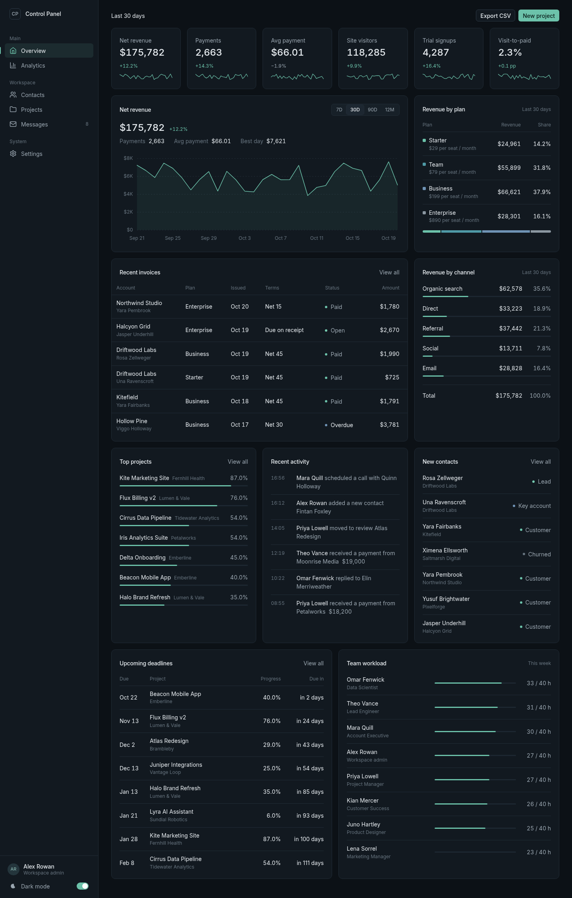
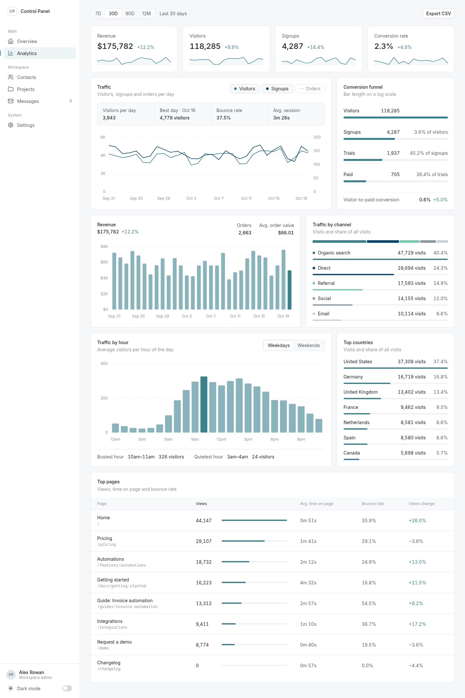
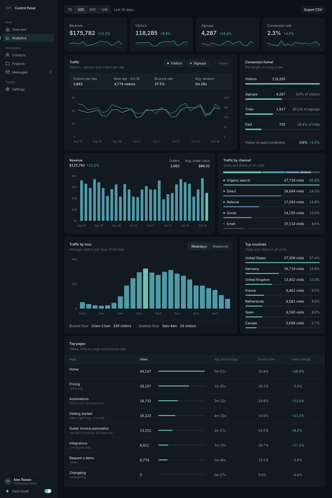
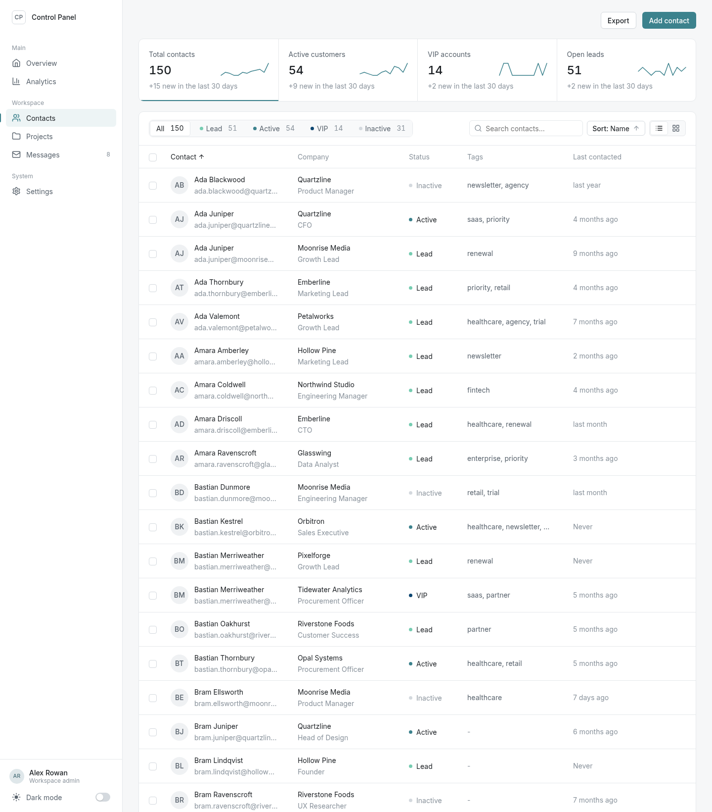
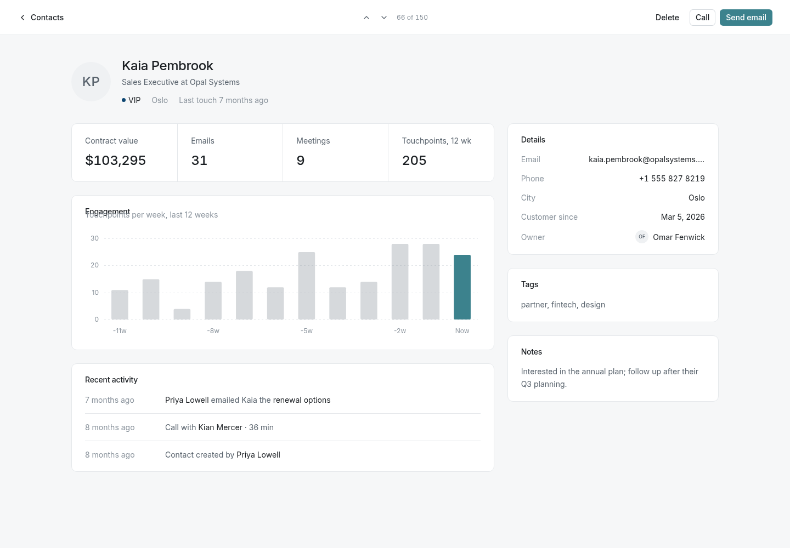
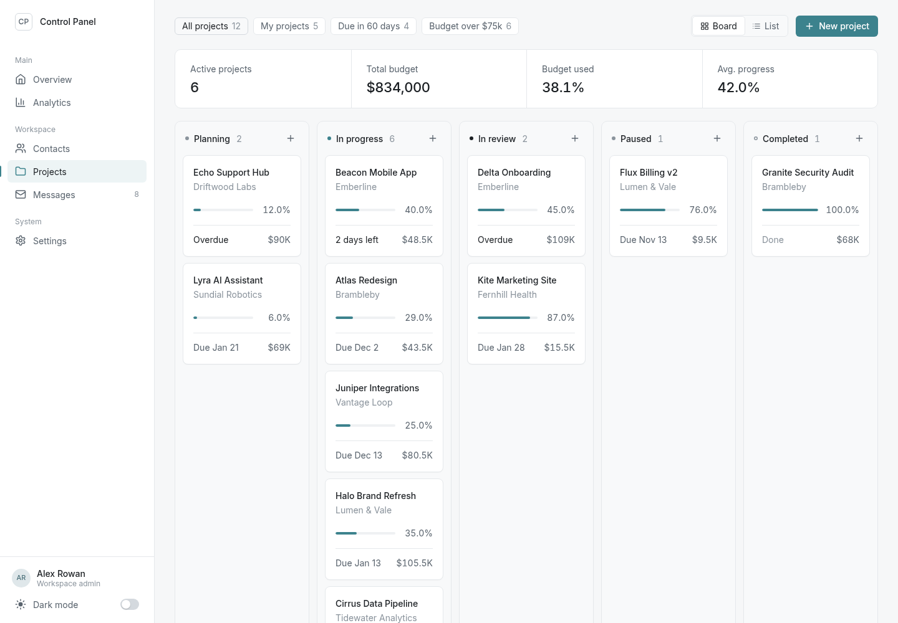
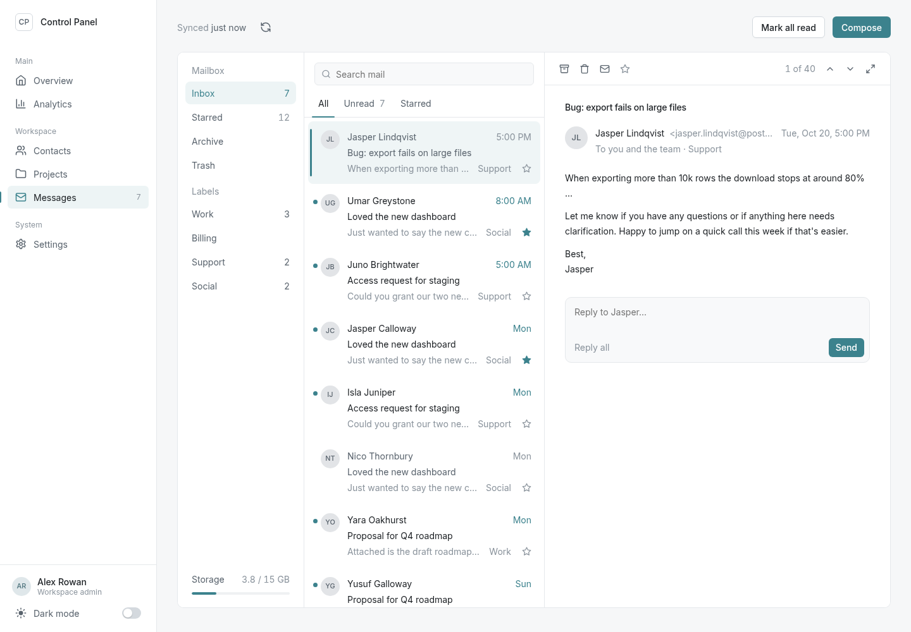
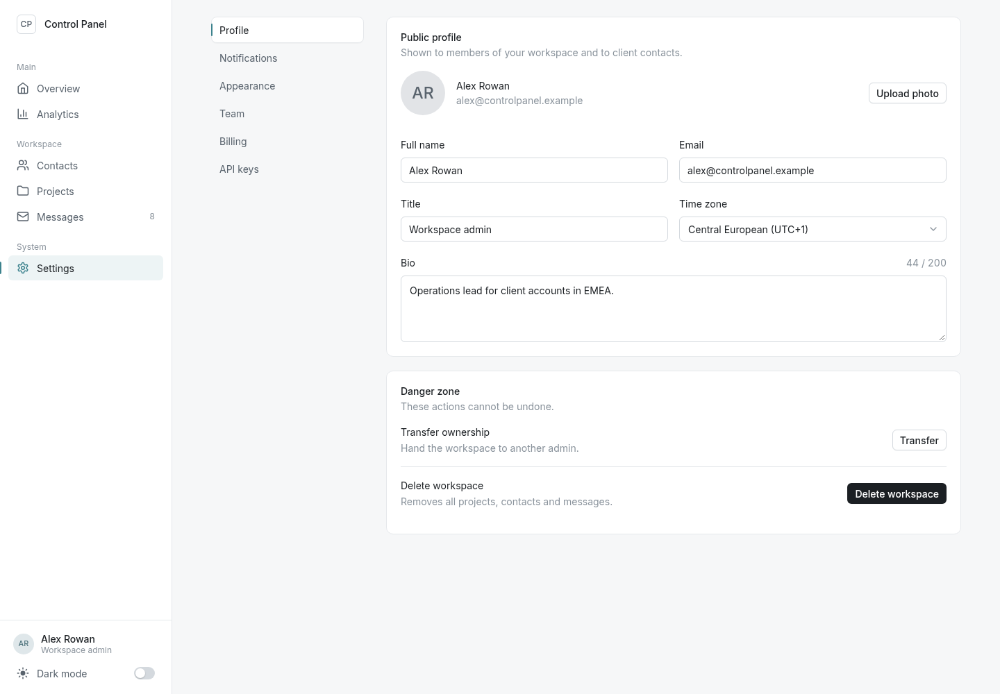

# Control Panel

**A local Django control panel that shows how to add calm, fast, tasteful motion to a web app.** Download it, run it, then point your AI coding agent at it so it can copy the same motion system into your own site.



Control Panel is a complete admin dashboard (Overview, Analytics, Contacts, Projects, Messages, Settings) filled with invented placeholder data. It isn't a product. It's a **reference implementation**: every interaction animates the way a polished work tool should, quickly and with intent, without getting in the way. It's built from plain CSS custom properties and a few small vanilla JS files, so you can lift it into any stack.

- **Calm, fast, never cute.** Motion uses crisp ease-out curves and 150–400 ms durations, with no overshoot, no bounce and no looping idle animation.
- **Token-driven.** Durations, easings and distances are CSS variables. Change one token and the whole UI follows.
- **Accessible.** `prefers-reduced-motion` sets every token to ~0, so motion turns off with no per-component work.
- **No build step and no runtime CDNs.** Vanilla JS, plain CSS, and Chart.js vendored locally.
- **Light mode by default.** A dark mode toggle sits at the bottom left with a circular reveal.

---

## Screenshots

| Light | Dark |
|---|---|
|  |  |
|  |  |

| Contacts | Contact drawer |
|---|---|
|  |  |

| Projects | Messages | Settings |
|---|---|---|
|  |  |  |

> Screenshots can't show motion. Run the app to see it, or read [docs/ANIMATIONS.md](docs/ANIMATIONS.md).

---

## What each page demonstrates

**App shell (every page)**
- Cross-document View Transitions: the sidebar stays perfectly still, the active nav pill glides to the new item, and the content fades over.
- The sidebar collapses to icons (`[` key): labels fade, section titles become dividers, and tooltips appear.
- Theme toggle with a circular reveal from the button and a sun/moon icon morph.
- A thin progress bar shows while the next page loads.

**Overview**
- KPI cards stagger in, numbers count up, and sparklines draw themselves, all synced to each card's reveal.
- Revenue chart draws in with a left-to-right wave. The 7D/30D/90D/12M tabs morph the data, and the total counts to its new value.
- Doughnut sweep, progress bars that fill on reveal, and a "live visitors" counter that ticks.
- Export button with a loading spinner and a success toast. A "New project" modal shakes the empty field on error.

**Analytics**
- One range control drives the whole page without a reload: every number tweens, charts morph, and bars resize.
- Country rows re-sort with FLIP. The top-pages table sorts by column with FLIP.
- A 7×24 heatmap that enters, and later re-colors, in a diagonal wave.
- Chart skeletons that fade out when the chart arrives. Series chips toggle lines, and the last active chip shakes instead of emptying the chart.
- Keyboard shortcuts `1`–`4` switch the range, and the range is kept in the URL (`?range=90`).

**Contacts**
- Status tabs and instant search: leaving rows exit, then the remaining rows FLIP into place.
- Sortable table, and a table/card view switch where avatars morph between layouts.
- When you select rows, a bulk-action bar slides up and its count updates.
- Contact drawer with staggered sections, count-ups and a mini chart. "Load more" shows a skeleton shimmer, then staggers rows in.

**Projects**
- Kanban board with pointer-based drag and drop. A card lifts, a dashed placeholder FLIPs through the column, and the card glides into its slot on drop (`Esc` cancels).
- Filter chips: cards that leave fade out and the rest FLIP to their new spots.
- Detail drawer with budget, progress and a milestone checklist.

**Messages**
- Three-pane inbox (folders, list, reading pane) with animated read/unread state and a compose modal.
- On narrow screens the reading pane slides in over the list.

**Settings**
- Form patterns: switches, color swatches, and save feedback with a loading state and toast.

---

## Quick start

You need Python 3.10 or newer. Everything runs locally on `127.0.0.1`.

**Linux / macOS**

```bash
git clone <repo-url> control-panel && cd control-panel
python3 -m venv .venv
source .venv/bin/activate
pip install -r requirements.txt
python manage.py migrate
python manage.py seed          # invented placeholder data (deterministic)
python manage.py runserver 127.0.0.1:8000
```

**Windows (PowerShell)**

```powershell
git clone <repo-url> control-panel; cd control-panel
py -m venv .venv
.venv\Scripts\Activate.ps1
pip install -r requirements.txt
python manage.py migrate
python manage.py seed
python manage.py runserver 127.0.0.1:8000
```

Then open <http://127.0.0.1:8000>.

Tips:
- Add `?theme=dark` or `?theme=light` to any URL to force a theme (useful for screenshots).
- Turn on "reduce motion" in your OS to see the accessible version.
- `python manage.py seed` wipes and regenerates all demo data.

---

## Adding your logo

The repo ships without any logo. Out of the box the sidebar shows a neutral placeholder: an outlined "CP" square next to the text "Control Panel".

To use your own, put the files in `static/img/brand/`. They are picked up on the next page load, and that folder is git-ignored, so they stay on your machine:

| File | Shown in |
|---|---|
| `logo.svg` | Expanded sidebar and mobile top bar (wide horizontal logo, at most 40 px tall) |
| `mark.svg` | Collapsed sidebar rail and the favicon (square, shown at 32 px) |
| `logo-dark.svg`, `mark-dark.svg` | Optional dark-mode variants |

`.png` and `.webp` work too. Details and sizes are in [static/img/brand/README.md](static/img/brand/README.md).

To take screenshots without your logo, start the server with `CONTROL_PANEL_PLACEHOLDER_LOGO=1` (PowerShell: `$env:CONTROL_PANEL_PLACEHOLDER_LOGO = "1"`). It forces the placeholder even when your files exist.

---

## Use this repo with your AI agent

The main reason this repo exists is to let a coding agent (Claude Code, Cursor, Copilot, Codex, etc.) add the same motion system to **your** site. Give the agent this repo, either the link or a local clone next to your project, and paste:

```text
Study <repo link>, especially docs/ANIMATIONS.md, static/css/tokens.css,
static/css/animations.css and static/js/motion.js. Then add the same motion
system to my site:

1. Copy the motion tokens (durations, easings, distances, and the
   prefers-reduced-motion override) into my global CSS.
2. Port the reveal-on-scroll + stagger primitive, the page-enter animation,
   and the hover/press micro-interactions that fit my UI.
3. Add animated open/close to my existing dropdowns, modals and toasts
   (exits faster than enters).
4. Where I have lists that filter or sort, use the FLIP pattern.
5. Keep it calm: ease-out curves only, no overshoot or bounce, no looping
   idle animations. Animate only transform and opacity, keep durations
   between 150 and 400 ms, cap staggers at 12 children, and make sure
   everything collapses to instant under prefers-reduced-motion.

Follow the "Porting checklist" in docs/ANIMATIONS.md. Don't change my
layout, colors or copy. Only add motion. Show me a list of what you
animated and where.
```

Smaller variants:

```text
Using <repo link>'s docs/ANIMATIONS.md as the reference, add a theme toggle
with the circular View Transition reveal and the sun/moon icon morph to my site.
```

```text
Read <repo link>'s docs/ANIMATIONS.md section "FLIP filtering and sorting" and
make my product grid animate when filters change.
```

[AGENTS.md](AGENTS.md) holds instructions aimed at agents working **inside** this repo.

---

## Project structure

```
nimbus/                  Django project settings and root URLs (internal package name)
dashboard/               the app: models, views, URLs, seed command, template tags, icon set
templates/
  base.html              app shell (head theme script, sidebar, scripts)
  components/            sidebar, stat_card, avatar, progress, ...
  dashboard/             one template per page
static/
  css/tokens.css         ALL design + motion tokens (light, dark, reduced motion)
  css/animations.css     reveal primitives, page enter, View Transitions, keyframes
  css/components.css     every component (state transitions live here)
  css/base.css           reset, shell layout, grid, utilities
  css/pages/             page-only styles
  js/motion.js           window.Nimbus: reveal, count-up, tabs, dropdown, modal, toast, FLIP, ...
  js/theme.js            light/dark with circular View Transition
  js/charts.js           Chart.js theming + draw-in, SVG sparklines
  js/app.js              shell: sidebar, nav pill, nav progress bar
  js/pages/              page scripts (overview.js is the reference)
  img/brand/             your logo files (git-ignored; see "Adding your logo")
  img/favicon.svg        generic favicon (used when there is no img/brand/mark.svg)
  vendor/                Chart.js 4.4.1 (local, no CDN)
  fonts/                 Inter variable
docs/
  ANIMATIONS.md          the motion guide: every pattern, with standalone snippets
  CONVENTIONS.md         how to build pages inside this project
  screenshots/
```

The code still uses the original internal name `nimbus` for identifiers (`window.Nimbus`, the Django package, keyframe names). The visible product name is Control Panel.

---

## Motion principles (summary)

| Principle | In practice |
|---|---|
| Calm, fast, never cute | Motion explains a change or confirms an action. It never decorates. |
| Fast | Hover is 150 ms, most enters 250 ms, larger travel 400 ms, and data motion (count-ups, fills) 700 ms. |
| Exits are faster than enters | The user has already decided, so don't make them wait. |
| Ease-out for enters | `cubic-bezier(.16,1,.3,1)`: quick start, soft landing. |
| Ease-in for exits | `cubic-bezier(.5,0,.75,0)`: the element accelerates away. |
| No overshoot, no loops, no bursts | No springs or bounce. Nothing pulses or wiggles while idle. No confetti. |
| Compositor-only | Animate `transform` and `opacity`. The two deliberate exceptions are progress widths and the sidebar width. |
| Capped stagger | 40 ms between children, and children after the 12th share the last delay. |
| Reduced motion | Tokens drop to 1 ms, distances to 0, and loops stop. |

The full rationale, the token table and copy-paste snippets for every pattern are in **[docs/ANIMATIONS.md](docs/ANIMATIONS.md)**.

---

## Tech stack

- **Django 5.2** with SQLite (local only, `DEBUG=True`, bound to 127.0.0.1)
- **Plain CSS** with custom properties. No preprocessor and no framework.
- **Vanilla JavaScript.** No bundler, no npm, no build step.
- **Chart.js 4.4.1**, vendored in `static/vendor/`
- **Inter** variable font, self-hosted
- Native browser APIs: View Transitions, Web Animations API, IntersectionObserver, `<dialog>`

---

## Contributing

See [CONTRIBUTING.md](CONTRIBUTING.md). All data must stay invented: no real people, companies or emails.

## Credits

Built with AI assistance (Claude by Anthropic).

## License

[MIT](LICENSE)
